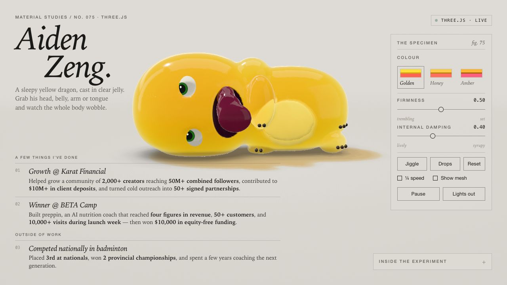

# aidenzeng



> **Jiggle it.**

**Live:** [aidenzeng.ca](https://aidenzeng.ca)

My personal site, with a real-time soft-body jelly creature you can grab, stretch, twist and wobble right in the browser. No physics engine, no build step. It's one HTML page, one hand-written simulation, and a lot of jelly.

---

## ✨ Features

| Feature | Description |
| --- | --- |
| 🍮 **Real soft-body physics** | An XPBD tetrahedral simulation (885 nodes, 2,890 tets) that keeps its volume when you squish it |
| ✋ **Grab anything** | Pick up the head, belly, arm or tongue and drag it around. Scroll while holding to twist it |
| 💧 **Glass-like jelly shading** | Custom shaders for light passing through the jelly, a milky inner layer, bubbles and soft contact shadows |
| 🎛️ **Specimen controls** | Three colours, firmness (*trembling → set*), internal damping (*lively → syrupy*), ¼ speed and a mesh view |
| 🌙 **Lights out** | The room goes dark and the whole page switches to a night theme with it |
| 🔊 **Squish sounds** | Optional Web Audio "blubs" that follow the wobble and get quieter as it settles |
| ♿ **Reduced motion aware** | Respects `prefers-reduced-motion` with heavier damping and gentler effects |

---

## 🎮 Controls

| Input | Action |
| --- | --- |
| **Drag the jelly** | Grab and pull |
| **Scroll while grabbing** | Twist the held patch |
| **Drag empty space** | Orbit the camera |
| **Scroll** | Zoom |
| **Double-click** | Reset the camera |
| `G` | Jiggle |
| `B` / `N` | Drops |
| `R` | Reset |
| `L` | Lights out |
| `Space` | Pause |

---

## 🚀 Local Setup

### Prerequisites
- A modern browser with **WebGL 2**
- Any static file server (the page uses ES modules and `fetch`s the mesh, so opening `index.html` straight from disk won't work)
- **Node.js** only if you want to rebuild the mesh

### Run

```bash
git clone https://github.com/aidenyzeng/aidenzeng.git
cd aidenzeng
python3 -m http.server 8000   # or: npx serve .
```

**Open:** [http://localhost:8000](http://localhost:8000)  
three.js r170 loads from jsDelivr through an import map, so there's nothing to install.

### Rebuild the mesh (after editing the shape)

```bash
node build-mesh.cjs                 # rebuild the simulation + render mesh
node build-mesh.cjs --render-only   # keep the physics lattice, update only the visible surface
node check-mesh.cjs                 # the surface is closed, finite and every detail is attached
node check-physics.cjs              # the sim settles, survives a grab and recovers its volume
```

**Checks:**
- ✅ `check-mesh` confirms **0 open edges** on the body surface
- ✅ `check-physics` confirms the sim stays **finite**, never sinks through the floor, and recovers to **within 5% of its rest volume**

---

## 🧪 How It Works

1. **Shape** → the creature is a signed distance field (SDF). Smooth unions of a swept body, head, arm, tongue and eyes make the shape
2. **Lattice** → the SDF is filled with a hex grid split into tetrahedra (5 per cell). That's what the physics simulates
3. **Surface** → a separate high-res surface is extracted with surface nets and tied to the lattice with barycentric weights, so it follows every wobble
4. **Physics** → each frame runs fixed XPBD substeps with co-rotational tet constraints for elasticity, volume constraints so it's nearly incompressible, edge damping for the syrupy feel, plus ground contact with friction
5. **Pack** → the mesh is baked into a compact quantized binary (`nailong-mesh.bin`, ~2.3 MB, down from a 15 MB JSON) that the page starts fetching before anything else
6. **Render** → three.js shaders measure how thick the jelly is along each view ray to tint the light passing through, all inside a procedural photo studio

---

## 📁 Project Structure

```
index.html          the site: layout, styles, specimen panel, experience & projects
nailong.js          geometry → physics → shaders → renderer → app, in one file
nailong-mesh.bin    the packed mesh the page loads
nailong-mesh.json   the build cache (read by --render-only and the checks)
build-mesh.cjs      regenerates the mesh from the SDF in nailong.js
pack-mesh.cjs       JSON → quantized binary
check-*.cjs         mesh and physics sanity checks
assets/             logos, icons, project media
review/             before/after screenshots, timing data and verification notes
```

---

## 👋 About

Built by **Aiden Zeng**, Management Engineering @ University of Waterloo. I'm looking for internship and full-time roles for 2027.

[LinkedIn](https://www.linkedin.com/in/aidenzeng/) · [GitHub](https://github.com/aidenyzeng) · [aidenzeng927@gmail.com](mailto:aidenzeng927@gmail.com)
